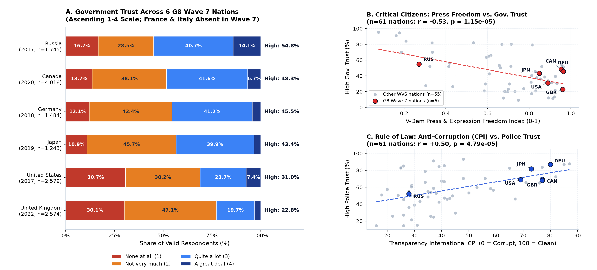
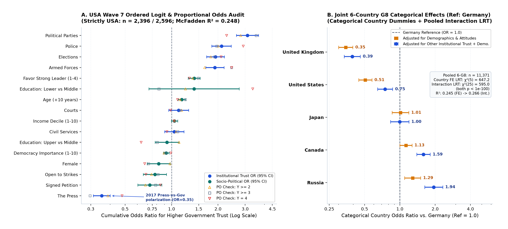
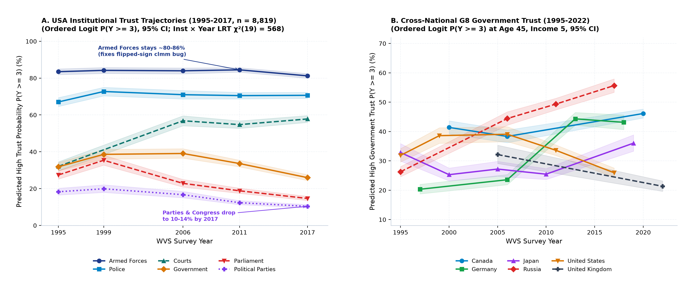
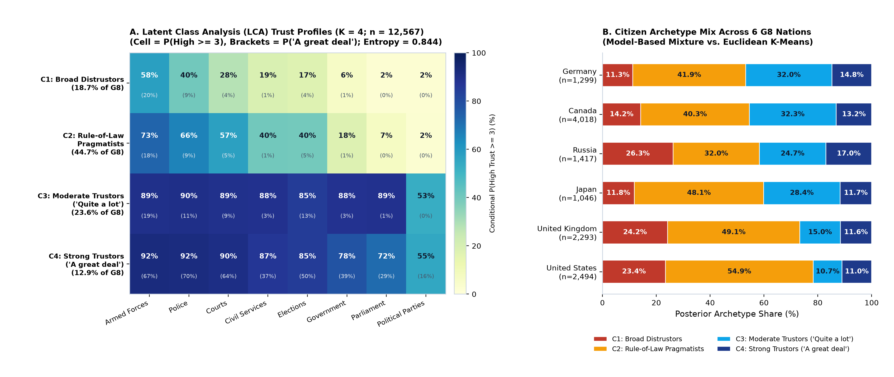

# World Values Survey: Cross-National & Longitudinal Analysis of Institutional Trust

Statistical modeling and latent-structure analysis of public trust in government and state institutions across **66 countries** (`97,220` respondents in WVS Wave 7, 2017-2022) and **27 years of multi-wave survey data** (WVS Time Series 1995-2022). Originally developed for *Case Studies II* at TU Dortmund University (Prof. Dr. Paul Bürkner and Dr. Šimon Kucharský) and rebuilt into a clean, unit-tested Python statistical pipeline following faculty review.

---

## Key Empirical Findings

| Research Axis | Scope & Sample | Core Finding |
| :--- | :--- | :--- |
| **RQ1: USA Determinants** | USA Wave 7 (2017), `n = 2,396` complete / `2,596` total | Trust in Political Parties (`OR = 3.10`), Police (`OR = 2.11`), Elections (`OR = 1.93`), and Armed Forces (`OR = 1.91`) drive higher government trust, while trusting The Press cuts government-trust odds sharply (`OR = 0.35`, `p = 3.9e-59`), reflecting acute 2017 partisan press-vs-executive polarization. |
| **RQ2: Joint G8 & Macro Link** | 6 G8 Wave 7 nations (`n = 11,371` pooled) + `61-62` global countries | Country fixed effects (`LRT chi2(5) = 647.2, p = 1.3e-137`) and `Country x Predictor` interactions (`LRT chi2(25) = 595.0, p = 1.3e-109`) are massive. Globally, rule-of-law Police trust rises with anti-corruption CPI (`r = +0.50, p = 4.8e-05`), whereas Government trust falls with V-Dem Press Freedom (`r = -0.53, p = 1.2e-05`) and Freedom House democracy (`r = -0.40`): the *Critical Citizens* paradox. |
| **RQ3: 1995-2022 Evolution** | USA `n = 8,819` (`48,436` stacked ratings) + 6 G8 nations | US institutional trust split sharply (`Inst x Year LRT chi2(19) = 567.7, p = 3.3e-108`): Armed Forces (`81-85%`) and Police (`67-73%`) stayed resilient, Courts rose (`32% -> 58%`), while Parliament (`35% -> 14.7%`) and Political Parties (`19.9% -> 10.4%`) collapsed, and "None at all" distrust of US Government doubled (`14.4% -> 30.6%`) between 2011 and 2017. |
| **Bonus: Citizen Archetypes** | Model-based LCA (`K = 4`), `n = 12,567` G8 Wave 7 respondents | Replacing Euclidean K-means with a categorical mixture (LCA, `Entropy = 0.844`) reveals four distinct archetypes: **Broad Distrustors (18.7%)**, **Rule-of-Law Pragmatists (44.7%)**, **Moderate Trustors "Quite a lot" (23.6%)**, and **Strong Trustors "A great deal" (12.9%)**, separating Germany/Canada/Japan from pragmatic USA/UK and bimodal Russia. |

---

## Methodological Audit & Engineering Upgrades

Rather than leaving course prototype notebooks as-is, every methodological issue surfaced during presentation and report review was fixed directly in pure NumPy/SciPy:

1. **Strict Cohort Filtering & Exact G8 Accounting:** Corrected the original USA model (which accidentally ran on all `97,220` global rows) to strictly filter `B_COUNTRY_ALPHA == "USA"` (`n = 2,596`), and documented accurately that WVS Wave 7 covers **6 G8 countries** (`Canada, Germany, Japan, Russia, UK, USA`; France and Italy last appeared in Wave 5, 2005-2006).
2. **Consistent Ascending Ordinal Scale & Proportional Odds Check:** Reverse-coded all WVS confidence items (`1 = A great deal .. 4 = None at all`) to **`1 = None at all`, `2 = Not very much`, `3 = Quite a lot`, `4 = A great deal`** so positive log-odds always signify *higher* trust. Kept all four ordered levels in one consistent **Cumulative Link Ordinal Logistic Regression** family (exact analytic gradient and analytic Fisher Hessian) instead of collapsing categories or mixing model families, and explicitly checked proportional odds across all three cumulative binary cutpoints (`Y >= 2`, `Y >= 3`, `Y = 4`).
3. **Valid Multicollinearity Diagnostics (`VIF >= 1.0`):** Fixed auxiliary regression intercepts and used `Middle Education` as the reference level (avoiding sparse `< 2%` Lower-Education reference inflation in the USA), bringing every USA predictor VIF into **`[1.03, 1.99]`**.
4. **Joint Cross-National Model & External Macro Data:** Replaced continuous numeric `Country` coding and invalid cross-dataset AIC comparisons with a single pooled 6-G8 ordinal model using categorical country dummies (Germany reference) and formal nested `Country x Predictor` Likelihood Ratio Tests, paired with external **World Bank GDP (PPP)**, **Transparency International CPI**, **Freedom House**, and **V-Dem Press Freedom / Liberal Democracy** indicators (strictly stripping `-9999` and `0.0` missing sentinel codes).
5. **Interpretable Longitudinal Predictions:** Replaced raw `fitted(clmm)` outputs (which return single-category observed-class probabilities `P(Y_i = y_i)` around `0.33-0.43`) with covariate-adjusted delta-method **predicted probabilities of High Trust `P(Y >= 3)` with 95% confidence bands** over explicit wave-year interactions.
6. **Latent Class Analysis (LCA) Replacing K-Means:** Replaced Euclidean K-means on discrete 1-4 ordinal ratings with multi-start **EM Categorical Finite Mixture Modeling (LCA)** over `K = 2..6` with BIC, SABIC, and normalized classification entropy, showing why preserving `"Quite a lot"` vs. `"A great deal"` matters empirically.

---

## Statistical Models

### 1. Cumulative Link Ordinal Logistic Regression

For ordered trust response $Y_i \in \{1, 2, 3, 4\}$ (`None at all` to `A great deal`) and predictor vector $\mathbf{x}_i \in \mathbb{R}^P$:

$$P(Y_i \le j \mid \mathbf{x}_i) = \sigma(\alpha_j - \mathbf{x}_i^\top \boldsymbol{\beta}), \qquad \alpha_1 < \alpha_2 < \alpha_3$$

where $\sigma(z) = (1 + e^{-z})^{-1}$. Under this standard parameterization (matching `MASS::polr` and `ordinal::clm`), $\beta_p > 0$ multiplies the cumulative odds of higher trust $P(Y > j)/P(Y \le j)$ by $\text{OR}_p = \exp(\beta_p)$. Parameters are estimated via `L-BFGS-B` with strictly ordered threshold reparameterization, exact analytic gradients, exact closed-form Hessian standard errors, and delta-method 95% confidence intervals for $P(Y \ge 3 \mid \mathbf{x}) = \sigma(\mathbf{x}^\top \boldsymbol{\beta} - \alpha_2)$.

### 2. Model-Based Latent Class Analysis (LCA)

For respondent $i$ answering $J = 8$ discrete 4-level institutional trust items $\mathbf{y}_i = (y_{i1}, \dots, y_{iJ})$:

$$P(\mathbf{y}_i) = \sum_{k=1}^{K} \pi_k \prod_{j=1}^{J} \theta_{k, j, y_{ij}}, \qquad \sum_{k=1}^K \pi_k = 1, \quad \sum_{m=1}^{4} \theta_{k,j,m} = 1$$

Estimated via multi-start EM (`12` Dirichlet restarts per $K \in \{2..6\}$) with log-sum-exp numerical stability and normalized classification entropy $E_K = 1 + \frac{1}{N \log K} \sum_{i,k} \gamma_{ik} \log \gamma_{ik}$.

---

## Visual Results & Diagnostics

### 1. G8 Government Trust & the Global Critical Citizens Paradox



- **Panel A (6 G8 Wave 7 Nations):** Russia (`54.8%`), Canada (`48.3%`), Germany (`45.5%`), and Japan (`43.4%`) sit well above the United States (`31.0%`) and the United Kingdom (`22.8%`). Notice the bottom tail: `30.7%` of US respondents and `30.1%` of UK respondents report `"None at all"`, roughly triple Japan (`10.9%`) and Germany (`12.1%`).
- **Panel B vs. Panel C (Global Macro Divergence, `n = 61` countries):** Across WVS Wave 7, government trust correlates **negatively** with V-Dem Press & Expression Freedom (`r = -0.53, p = 1.15e-05`), V-Dem Liberal Democracy (`r = -0.41, p = 9.0e-04`), and Freedom House democracy (`r = -0.40, p = 1.3e-03`), and shows virtually zero linear association with GDP per capita (`r = +0.03, p = 0.83`). By contrast, trust in **rule-of-law Police** rises strongly with Transparency International CPI (`r = +0.50, p = 4.79e-05`), GDP PPP (`r = +0.40`), and HDI (`r = +0.39`), with **Courts** tracking CPI positively (`r = +0.36, p = 0.0045`). Free societies tolerate vocal partisan criticism of sitting executives while maintaining high confidence in impartial legal enforcement (`Germany: 86.8% Police / 74.9% Courts`; `Japan: 81.7% / 85.6%`), whereas Russia shows the exact inversion (`54.8% Government` vs. `52.1% Police / 47.9% Courts`, `CPI = 28`).

### 2. USA Individual Determinants & Joint 6-Country G8 Model



- **Panel A (USA Wave 7, `n = 2,396` complete / `2,596` total; `McFadden R² = 0.248`, `VIF in [1.03, 1.99]`):** Institutional trust items strongly predict government trust (`LRT vs. socio-political baseline: chi2(7) = 1,138.6, p < 1e-200`), led by Political Parties (`OR = 3.10`, 95% CI `[2.63, 3.66]`), Police (`OR = 2.11`), Elections (`OR = 1.93`), and Armed Forces (`OR = 1.91`). Strikingly, trusting **The Press** sharply lowers odds of trusting the 2017 US Government (`OR = 0.35`, `[0.31, 0.40]`, `p = 3.9e-59`), while favoring a **Strong Leader** (`OR = 1.40`) and older **Age** (`OR = 1.16` per decade) raise them and civic protest (`Signed Petition OR = 0.72`, `Open to Strikes OR = 0.78`) lowers them. Open markers overlay the three binary cutpoint regressions (`Y >= 2`, `Y >= 3`, `Y = 4`), confirming stable proportional-odds directions across nearly all predictors.
- **Panel B (Joint 6-Country G8 Model, `n = 11,371`; Ref = Germany):** Relative to Germany (`OR = 1.0`), full institutional + demographic odds of higher government trust are `1.94x` in Russia and `1.59x` in Canada, indistinguishable in Japan (`1.00x`), and lower in the USA (`0.75x`) and UK (`0.39x`). Adding `Country x Predictor` interactions (`LRT chi2(25) = 595.0, p = 1.3e-109`) shows that regime context reshapes individual slopes: relative to parliamentary Germany, `Favor Strong Leader` boosts executive government trust far more in 2017 USA (`interaction OR = 2.16, z = +10.21`), while `Political Parties` couples much less tightly to government trust in presidential USA (`interaction OR = 0.35, z = -8.64`) and Russia (`interaction OR = 0.50, z = -5.69`).

### 3. Multi-Decade Institutional Trust Evolution (1995-2022)



- **Panel A (USA 1995-2017, `n = 8,819` respondents / `48,436` ratings):** Evaluating covariate-adjusted `P(High Trust >= 3)` at `Age = 45, Income = 5` resolves the original sign-inversion and `fitted(clmm)` bugs cleanly. **Armed Forces** (`81.2-84.5%`) and **Police** (`67.0-72.7%`) remain consistently high over 22 years, and **Courts** recover from `32.1%` (1995) to `57.8%` (2017). By contrast, **Parliament / Congress** drops from `35.4%` (1999) to `14.7%` (2017) and **Political Parties** slides from `19.9%` to `10.4%`. Meanwhile, raw `"None at all"` distrust of US Government more than doubled from `14.4%` (2011) to `30.6%` (2017), driving covariate-adjusted high-trust probability down from `39.1%` (2006) to `25.9%` (2017).
- **Panel B (6 G8 Nations, 1995-2022):** Institutional trust is not universally declining across advanced economies. Covariate-adjusted government trust climbed in **Germany** (`20.3%` in 1997 to `43.1%` in 2018), **Canada** (`38.3%` in 2006 to `46.1%` in 2020), **Japan** (`25.5%` in 2010 to `36.0%` in 2019), and **Russia** (`26.3%` in 1995 to `55.6%` in 2017), while falling steeply in the **USA** (`39.1%` in 2006 to `25.9%` in 2017) and the **United Kingdom** (`32.1%` in 2005 to `21.3%` in 2022).

### 4. Latent Class Analysis (LCA): Citizen Trust Archetypes



| Archetype (`K = 4`, `n = 12,567`, `Entropy = 0.844`) | G8 Share | Armed Forces / Police / Courts (`High >= 3`) | Gov / Parliament / Parties (`High >= 3`) | Avg `"A great deal"` | Strongest Country Shares |
| :--- | :---: | :---: | :---: | :---: | :--- |
| **C1: Broad Distrustors** | `18.7%` | `58% / 40% / 28%` | `6% / 2% / 2%` | `5.0%` (`50.6%` None) | Russia (`26.3%`), UK (`24.2%`), USA (`23.4%`) |
| **C2: Rule-of-Law Pragmatists** | `44.7%` | `73% / 66% / 57%` | `18% / 7% / 2%` | `4.9%` (`57.0%` Not much) | USA (`54.9%`), UK (`49.1%`), Japan (`48.1%`) |
| **C3: Moderate Trustors ("Quite a lot")** | `23.6%` | `89% / 90% / 89%` | `88% / 89% / 53%` | `7.4%` (`76.5%` Quite a lot) | Canada (`32.3%`), Germany (`32.0%`), Japan (`28.4%`) |
| **C4: Strong Trustors ("A great deal")** | `12.9%` | `92% / 92% / 90%` | `78% / 72% / 55%` | `46.5%` (`67-70%` Forces/Police) | Russia (`17.0%`), Germany (`14.8%`), Canada (`13.2%`) |

Preserving all four ordinal response levels directly validates the LCA model choice: collapsing `"Quite a lot"` and `"A great deal"` into a binary target would merge **C3** (measured democratic institutionalists concentrated in Canada, Germany, and Japan) with **C4** (high-intensity trustors peaking in Russia, which simultaneously holds the largest C1 Broad Distrustor share at `26.3%`, revealing bimodal polarization).

---

## Repository Structure

```text
World-Value-Survey/
├── src/
│   ├── ordinal_model.py        # Exact Cumulative Link Ordered Logit (analytic grad/Hessian), LRT, PO check, VIF
│   ├── latent_class.py         # Multi-start EM Latent Class Analysis (BIC, SABIC, Entropy)
│   └── run_wvs_analysis.py     # End-to-end WVS Wave 7 + Time Series 1995-2022 pipeline & figures
├── tests/
│   └── test_wvs_pipeline.py    # Unit tests: analytic grad/Hessian vs FD, parameter/SE recovery, VIF, LCA EM
├── results/                    # Exported CSV tables & summary_metrics.json
├── figures/                    # 4 high-resolution diagnostic figures
├── requirements.txt
└── LICENSE
```

---

## Reproduction

### 1. Obtain the Official WVS Datasets

Raw WVS survey CSVs are excluded from version control due to size (`> 500 MB`) and redistribution terms. Download both official CSV releases from the [World Values Survey Association](https://www.worldvaluessurvey.org/) and place them under `data/`:

- `data/wave_7.csv` (WVS Wave 7 Cross-National Dataset, v6.0)
- `data/time_series_1981_2022.csv` (WVS Time-Series 1981-2022 Dataset, v5.0)

### 2. Install Dependencies, Verify Unit Tests & Run Pipeline

```bash
pip install -r requirements.txt
python -m unittest discover -s tests -v
python -m src.run_wvs_analysis --data-dir data --out-dir .
```

All CSV summary tables are written to `results/` and all four figures to `figures/`.

---

## Data Citations

- Haerpfer, C., Inglehart, R., Moreno, A., Welzel, C., Kizilova, K., Diez-Medrano, J., Lagos, M., Norris, P., Ponarin, E., & Puranen, B. (eds.). (2022). *World Values Survey: Round Seven - Country-Pooled Datafile Version 6.0*. Madrid & Vienna: JD Systems Institute & WVSA Secretariat. `doi:10.14281/18241.24`
- Inglehart, R., Haerpfer, C., Moreno, A., Welzel, C., Kizilova, K., Diez-Medrano, J., Lagos, M., Norris, P., Ponarin, E., & Puranen, B. (eds.). (2022). *World Values Survey Time-Series (1981-2022) Cross-National Data-Set Version 5.0*. Madrid & Vienna: JD Systems Institute & WVSA Secretariat. `doi:10.14281/18241.22`
